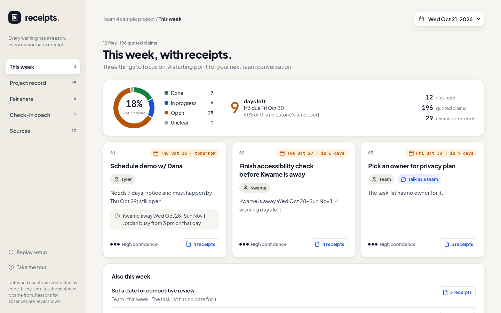
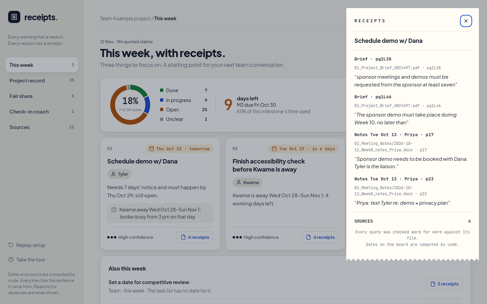
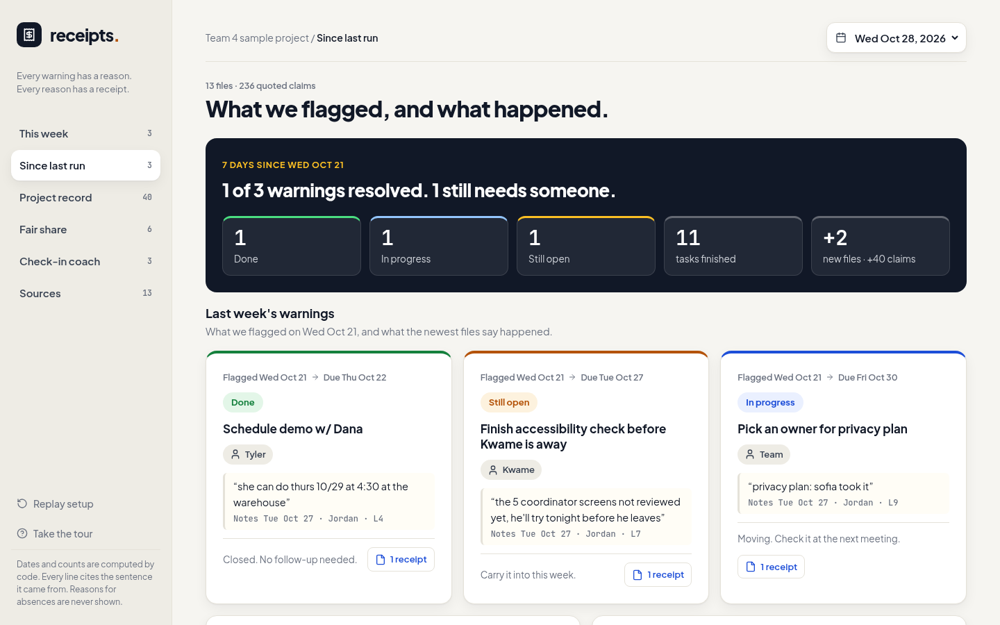

# Receipts

**What will go wrong before the next deadline, who can stop it this week, and how we know.**

Receipts reads a student team's project folder (meeting notes, task list, course brief, availability sheet) and returns the three things that matter this week. Each comes with a person, a date, a reason, and a receipt: the exact quote, file, and line it came from.

Built in one afternoon at the **Coug AI Build Challenge** (Oct 23, 2026).



## The demo moment

The organizers gave every team the same fictional kit: Team 4, six students in UNIV 497, building a volunteer app for a food bank. The kit holds 12 files from 5 different note-takers, and the files don't agree.

**Run it on Wednesday of Week 9.** Card 1 says *schedule the sponsor demo by tomorrow, Thu Oct 22.* The brief requires 7 days' notice, the demo has to happen by Oct 29, and the latest notes say nobody has asked yet. No single file says that. It comes from a course rule in a PDF combined with a status line in someone's meeting notes.



**Run it again a week later.** The Week 10 notes show the request went out on Oct 23, one day late. It only went ahead because the instructor made an exception. The recap reports what happened to each of last week's warnings and quotes the line that settled it.



## How it works

Four stages. Each writes a plain file that a person can open and fix before the next stage reads it.

| # | Stage | Done by | Writes |
|---|---|---|---|
| 01 | **Ingest**: docx, txt, xlsx, and pdf become numbered lines with a doc date and author | code | `01_docs.jsonl` |
| 02 | **Extract**: typed claims (task, deadline, rule, availability, …), each with a verbatim quote | LLM | `02_claims.jsonl` |
| 03 | **Reconcile**: detectors for lead-time squeezes, owners who are away, rubric gaps, sources that disagree, and more | code | `03_findings.json` |
| 04 | **Brief**: ranks the findings, words the cards, and diffs against the previous run | code | `04_brief.json`, board HTML |

The split is the point. **Code does every date and count.** The model only turns documents into quoted claims, and every quote is checked word for word against its source line. A claim that doesn't match is dropped and logged in `02_dropped.jsonl`.

Nothing about Team 4 is hard-coded. The roster comes from the documents, course rules come from the brief, and "today" comes from the input folder's name (`inputs/team4@2026-10-21`). The detectors are listed in [`_shared/detectors.md`](_shared/detectors.md).

## Responsible AI

A tool that names people can hurt people, so the rules in [`_shared/voice.md`](_shared/voice.md) were written before the code:

- It shows constraints, never reasons: "away Oct 28 – Nov 1", never why.
- It never ranks or scores people. The Fair share view says *"Counts aren't contribution."*
- Cards about a person carry a **Talk as a team** tag. The board starts a conversation. It doesn't hand down verdicts.
- If a sentence has no receipt, it doesn't go on the board.
- Extraction can run on a local model, so team notes never have to leave your machine.

## Run it

The cached runs for both weeks are committed, so the app works offline with no API key:

```bash
git clone https://github.com/rippere/coug-receipts.git && cd coug-receipts
open runs/index.html            # or xdg-open; it's one static page
```

Rebuild the boards from the cached claims (stages 03–04, no model needed):

```bash
uv sync
uv run python receipts.py inputs/team4@2026-10-21 --from 03
uv run python receipts.py inputs/team4@2026-10-28 --from 03
uv run --with pytest pytest -q        # detector tests, including real Week 9 claims
```

Run the full pipeline, extraction included:

```bash
# Option A: any OpenAI-compatible server (vLLM, llama.cpp, Ollama)
export RECEIPTS_BASE_URL=http://localhost:8000/v1
# Option B: Claude
export RECEIPTS_PROVIDER=anthropic ANTHROPIC_API_KEY=...

uv run python receipts.py inputs/team4@2026-10-21
```

To try your own project, copy its files into `inputs/<name>@<YYYY-MM-DD>/` and run the same command.

## Limits

- It only knows what's written down. Group chat, email, and Figma are invisible to it.
- Reading messy notes is imperfect, which is why claims are editable and confidence is always shown.
- Matching "WCAG review" to "accessibility check" is a judgment call. Two rows in the Week 10 disagreements panel are matching errors.
- It can open a conversation about workload. It can't tell how anyone feels.

## How we built it in one afternoon

The repo is laid out so five lanes could build in parallel without merge conflicts. Each stage folder has one owner and one contract (`stages/0N_*/CONTEXT.md`). Hand-made fixtures in `_shared/fixtures/` let every lane start before the lane upstream worked. A validator (`_shared/validate.py`) checked each handoff, and a golden file (`_shared/golden-team4.md`) served as the acceptance test.

- [`spec.html`](spec.html): the one-page spec we shared at kickoff
- [`CONTEXT.md`](CONTEXT.md): the plan, the lanes, and the timeline (10:45 kickoff, 1:30 freeze, 2:00 demos)
- [`_shared/interfaces.md`](_shared/interfaces.md): lane contracts and git rules
- [`demo/`](demo/): the 5-minute pitch script and talking points

## Team

- **Ben Rippere** ([@rippere](https://github.com/rippere)): spec and architecture, the four-stage pipeline, the app
- **Evan** ([@kapsaevan](https://github.com/kapsaevan)): story and pitch, demo script, sponsor-feedback and data-privacy docs
- **Ethan** ([@echun808](https://github.com/echun808)): app design (a Figma prototype whose navigation we merged in), reconcile fixes on real data

The Team 4 kit in `inputs/` comes from the Coug AI Build Challenge organizers. Everything in it is fictional.
